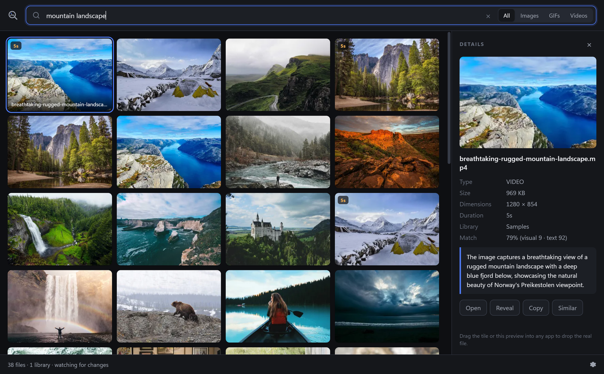
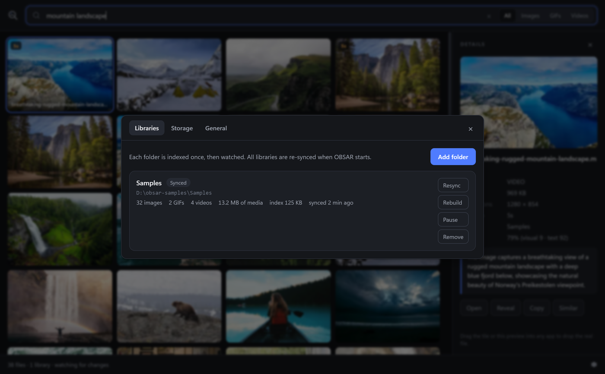
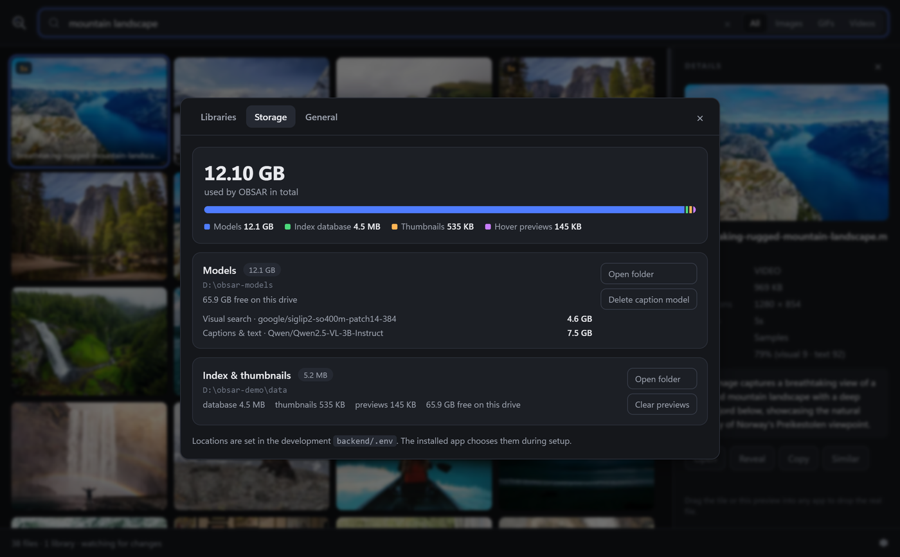
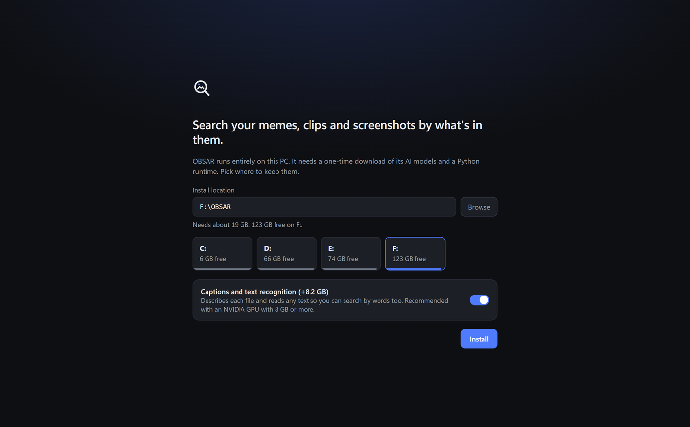

# OBSAR

[](https://github.com/andrewporasl/OBSAR/releases/latest)
[](https://github.com/andrewporasl/OBSAR/actions/workflows/ci.yml)
[](LICENSE)

Local semantic search over your folders of images, GIFs and videos. Type what you remember
("blue", "ronaldo meme", "guy with headphones", a line of text from a meme) and drag the result
straight out of the window into Explorer, Discord, Slack, Premiere, a browser upload box, anywhere.

Everything runs on your PC. Nothing leaves it.



<table>
  <tr>
    <td></td>
    <td></td>
  </tr>
  <tr>
    <td align="center"><sub>Libraries: per-folder counts, sync state, resync / rebuild / pause / remove</sub></td>
    <td align="center"><sub>Storage: exactly what OBSAR uses and where</sub></td>
  </tr>
</table>

<p align="center"><br><sub>First run: pick a drive, see the download size, watch it install inside the app</sub></p>

## Download

**[Download the latest installer](https://github.com/andrewporasl/OBSAR/releases/latest)** (`OBSAR-Setup-x.y.z.exe`, ~100 MB) and run it.

The build is not code-signed, so Windows SmartScreen shows "Windows protected your PC" the first
time. Click **More info → Run anyway**.

On first launch OBSAR asks where to keep its data and then installs a Python runtime, the AI
libraries and the models into that folder, with progress shown in the app. This is a one-time
download of about **19 GB** (or 11 GB without captions). After that it works fully offline.

Requirements: Windows 10/11 64-bit, 20 GB free on the chosen drive, an NVIDIA GPU with 8 GB+ VRAM
for captions (visual search alone runs on any GPU or on the CPU), internet for the first run only.

**Updates** are automatic: the app checks GitHub Releases on launch, downloads in the background,
and asks you to restart. **Uninstalling** from Windows Settings removes the app and asks whether to
also delete the models and index folder it installed.

## Using it

1. **Add a folder.** Subfolders are included. Add as many libraries as you like in Settings.
2. **Wait for the first sync.** Files appear in search as they finish. ~1 to 2 seconds per file on
   a modern GPU with captions on, ~0.2 seconds with captions off.
3. **Search** by what it looks like, what it says, or its filename. Results update as you type.
4. **Drag** a tile into any app. Ctrl-click or Shift-click to select several and drag them together.

| Action | How |
| --- | --- |
| Filter by type | All / Images / GIFs / Videos in the search bar |
| Filter by library | dropdown in the search bar (shown with 2+ libraries) |
| Open / Reveal / Copy / Similar / Re-index | right-click a tile, or the buttons in the detail panel |
| Open a file | double-click, or Enter |
| Settings | gear icon in the status bar, or `Ctrl+,` |
| Summon the window from anywhere | `Ctrl+Shift+Space` |
| Focus search | `Ctrl+F`; `Esc` clears |

Dropping new files into a library folder indexes them within a few seconds. Deletes and renames are
tracked. Every library is re-synced when OBSAR starts, so changes made while it was closed are caught.

### Settings

- **Libraries**: each folder with its counts, media size, index size and last sync. Resync (scan for
  changes), Rebuild (re-caption everything), Pause, Remove. Removing offers to keep the index so
  re-adding is instant, or delete it.
- **Storage**: exactly what OBSAR uses and where: models, index database, thumbnails, hover
  previews, plus free space on each drive. Open the folders, clear previews, delete or re-download
  the 8 GB caption model.
- **General**: sync on launch, captions on/off, global shortcut, tray, offline mode, backend log.

## How it works

Two pieces: a **Python backend** (`backend/`, FastAPI) that indexes and searches, and an
**Electron + React app** (`app/`) that spawns it, shows the grid, and does native file drag-out.

### Indexing (once per file, then kept in sync)

```
 your libraries (recursive)                     watchdog file watcher
 ┌────────────────────┐   launch-time walk      ┌───────────────────────┐
 │ photo.jpg          │ ─────────────────────▶  │ created / modified /  │
 │ meme.png           │                         │ deleted / renamed     │
 │ clip.mp4  cat.gif  │ ◀───── live events ──── │ (debounced ~1.5 s)    │
 └────────────────────┘                         └───────────┬───────────┘
                                                            │ enqueue
                                                            ▼
                        ┌──────────────────────────────────────────────┐
                        │ decode  →  frames                            │
                        │   image: 1 frame   gif: ≤4   video: 3–12     │
                        └───────────┬─────────────────────┬────────────┘
                                    │ every frame         │ first / middle / last
                                    ▼                     ▼
                     ┌──────────────────────┐   ┌──────────────────────────┐
                     │ SigLIP2 image encoder│   │ Qwen2.5-VL (vision LLM)  │
                     │ frame → 1152-d vector│   │ "CAPTION: …  TEXT: …"    │
                     └───────────┬──────────┘   └────────────┬─────────────┘
                                 ▼                           ▼
                     ┌──────────────────────┐   ┌──────────────────────────┐
                     │ embeddings table     │   │ files_fts (SQLite FTS5)  │
                     │ (file, frame, vector)│   │ caption + ocr + filename │
                     └──────────────────────┘   └──────────────────────────┘
                                 ▲ loaded into one numpy matrix in RAM
```

- Images give one frame. GIFs and videos give several evenly spaced frames (ffmpeg for video), so a
  person who only appears at the end of a clip is still embedded.
- **SigLIP2** turns every frame into a vector that encodes what it *looks like*. No words involved.
- **Qwen2.5-VL** looks at the representative frames and writes a one-sentence caption plus a verbatim
  transcript of any visible text (meme captions, HUD text, screenshots). That is the text you see in
  the detail panel. Optional; turn it off for visual-only search.
- A file is only re-processed when its size or modification time changes, so restarts are fast.

### Searching (every keystroke)

```
                 "ronaldo meme"
                       │
         ┌─────────────┴──────────────┐
         ▼                            ▼
 SigLIP2 text encoder          SQLite FTS5 match
 query → 1152-d vector         caption / ocr / filename
         │                     (all words, else any word)
         ▼                            │
 cosine vs every frame vector         │
 max over a file's frames             │
         │                            │
         ▼                            ▼
   visual score (0–1)           text score (0–1)
         └──────────┬─────────────────┘
                    ▼
      score = 0.65·visual + 0.35·text  (+0.08 if both hit)
                    ▼
        top results → thumbnails → grid
```

- **Visual side**: your query is embedded with the *same* model as the frames, into the same vector
  space. "blue", "knife in a video game", "cristiano ronaldo celebrating" all work with no tags,
  because the model learned what those things look like. This is the part that finds things whose
  caption never mentions your words.
- **Text side**: your words are matched against the caption, the transcribed text and the filename.
  This is the part that nails exact phrases like "press b to buy" or a filename fragment.
- **Fusion**: both scores are normalised within the current search and blended. The match percentage
  in the detail panel is that blend, so it is relative to the other results, not an absolute grade.
- **Empty query** shows the most recently modified files. **Similar** uses a file's own vector as the
  query.

### Footprint

Per file the index stores 2.3 KB per embedded frame (so 2 KB for an image, up to 28 KB for a video),
a few hundred bytes of text, and a ~20 KB thumbnail. A 5,000-file library is roughly 150 to 300 MB,
under 1% of the media. The models are a fixed 12 GB (4.6 GB visual + 7.5 GB captions).

### App shell

Electron starts the backend as a child process on a random local port, polls `/status` for progress,
and renders results from `/search`. Dragging a tile calls Electron's `startDrag` with the real file
path, so the drop target (Explorer, Discord, Premiere, a browser) receives an ordinary file. The
backend binds to `127.0.0.1` only. The installed app keeps everything it installs under the folder
you pick during setup (`data\` for the runtime and index, `models\` for the models).

## Releasing a new version

1. Bump `version` in `app/package.json`, add a section to `CHANGELOG.md`, commit to `main`.
2. `git tag vX.Y.Z && git push origin vX.Y.Z`.
3. GitHub Actions builds the installer on a Windows runner and publishes the release with
   `OBSAR-Setup-X.Y.Z.exe`, `latest.yml` and the blockmap. Installed copies update themselves.

## Development

Requirements: Python 3.11+ with [uv](https://docs.astral.sh/uv/), Node 20+.

```powershell
cd backend
uv sync                      # torch cu128, transformers, fastapi … into backend/.venv
copy .env.example .env       # optional: put models/index on a drive with space
cd ..\app
npm install
npm run dev                  # starts the backend from backend/.venv and opens the window
```

Backend on its own:

```powershell
cd backend
.venv\Scripts\python -m obsar.main --root "C:\path\to\media" --port 8765
curl "http://127.0.0.1:8765/search?q=blue"
```

`--no-captions` skips the caption model. `OBSAR_EMBED_MODEL` / `OBSAR_CAPTION_MODEL` swap models.

### Building the installer

```powershell
cd app
npm run dist                 # downloads uv.exe, builds, writes release/OBSAR-Setup-<version>.exe
```

The installer bundles the Electron app, the backend source, `uv.lock` and `uv.exe`. The Python
runtime, dependencies and models are installed on the user's machine during first-run setup, which
keeps the download at ~150 MB and lets the user choose the drive.

## Layout

```
backend/obsar/
  main.py      FastAPI: /search /similar /thumb /preview /status /libraries /storage /settings /models
  indexer.py   per-library reconcile, work queue, GPU worker, in-memory vector store
  watcher.py   one watchdog observer, one watch per library
  models.py    SigLIP2 embedder, Qwen2.5-VL captioner, model download with progress
  media.py     image / GIF / video (ffmpeg, hidden window) frame extraction
  search.py    hybrid ranking
  storage.py   sizes, locations, free space, cache cleanup
  db.py        SQLite schema, migrations, queries
  thumbs.py    thumbnail + animated preview cache
app/
  electron/main.ts     backend process, window, tray, hotkey, drag-out, settings, setup IPC
  electron/setup.ts    first-run installer (uv python install, uv sync)
  electron/preload.ts  window.obsar bridge
  src/App.tsx          shell; components/ for search bar, grid, detail, status, settings, setup
  scripts/fetch-uv.mjs pins and downloads uv.exe for packaging
```
